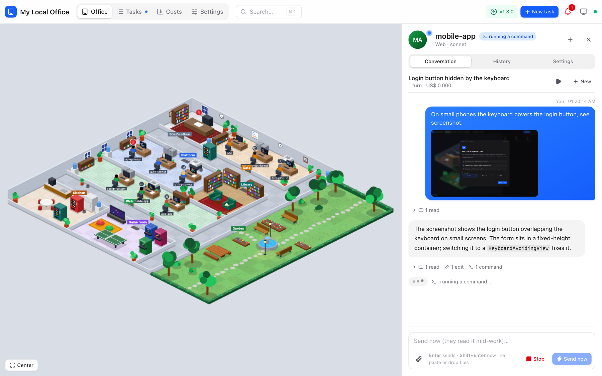
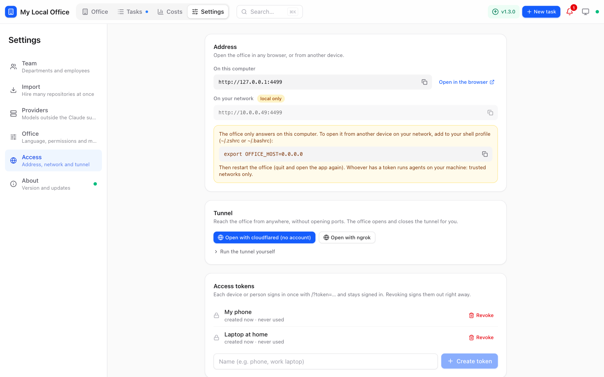

# My Local Office

**A virtual office for your [Claude Code](https://docs.claude.com/claude-code) agents, running on your machine.**

Every repository gets an AI employee. Employees sit in departments, ask each other questions, hand work to each other and come to you before anything risky. You watch it happen in an isometric office and approve, answer or redirect with one click.


```bash
curl -fsSL https://github.com/alissonpelizaro/my-local-office/releases/latest/download/install.sh | bash
```

macOS and Linux. Needs [Claude Code](https://docs.claude.com/claude-code) installed and logged in; everything else comes bundled.

## Why

Running one Claude Code session per repo in a dozen terminals does not scale. You lose track of who is doing what, agents can't ask the repo next door how its API works, and every `git push` prompt sits in a tab you are not looking at.

My Local Office gives that crowd a place to work:

- **One employee per repo.** Each task is a real `claude -p` run in that repo, so your `CLAUDE.md`, skills and allowlists keep working.
- **Agents that talk to each other.** A built-in MCP lets employees find who owns what, ask a colleague (who reads their own code to answer) and delegate tasks across repos.
- **You stay the boss.** Reading, tests and local edits just happen. Pushes, PRs, deletions and anything outside the repo wait for you, as a card in the chat and a notification on your desktop.
- **Local first.** A small Node server and a SQLite file. Use your Claude subscription, or any Anthropic- or OpenAI-compatible provider (LiteLLM, Ollama…).

## What it looks like

| Chat, plan and permission requests | Paste screenshots and files into the chat |
|---|---|
|  |  |

| Tasks now, later or on repeat | Your office from anywhere |
|---|---|
|  |  |

## Features

- **Departments and employees.** Group repos by product or team; each department is a room. Hire many repos at once from a folder. A quick read-only onboarding writes each employee's profile so colleagues know whom to ask.
- **Interns.** Employees without a repo, for research, writing and errands. They ask the owners when code is involved.
- **Conversations.** Click an employee to chat. Messages continue the same Claude session, land mid-turn if it is busy, and can carry images and files (paste, drop or pick). Sessions you started in a terminal or IDE can be picked up too.
- **Permissions that make sense.** External actions (`git push`, PRs, publishing, sending messages) and destructive ones (`git reset --hard`, `rm -r`, SQL writes) always ask, unless you "always allow" them for that employee.
- **Scheduling.** Run a task now, at a set time or every N minutes, with an optional pre-check command so idle runs spend no tokens.
- **Worktrees.** Run an employee in its main checkout or always in an isolated `git worktree`; parallel tasks get one automatically.
- **Costs.** Spend per day, department and employee (on a subscription, the API-price equivalent).
- **Providers.** Per employee or per department: your Claude subscription, an Anthropic-compatible API, or an OpenAI-compatible one through the built-in bridge (set Ollama's context to ~64K).
- **Remote access.** Create access tokens and open a tunnel (cloudflared or ngrok) from Settings to use the office from your phone.
- **Desktop app.** Lives in the tray / menu bar, sends native notifications and updates itself. English, Portuguese and Spanish.

## Install

```bash
curl -fsSL https://github.com/alissonpelizaro/my-local-office/releases/latest/download/install.sh | bash
```

It installs the **My Local Office** app (`/Applications` on macOS, an AppImage in `~/.local/bin` on Linux) and opens it. A setup assistant asks for your language, who does the work (Claude subscription or a provider) and your first hires.

Closing the window keeps the office running in the tray; quit from the tray menu or ⌘Q (running tasks stop). Data lives in `~/.my-local-office/data`. The UI is also at **http://127.0.0.1:4410** in any browser.

| Option | |
|---|---|
| `--version v1.2.0` | Install a specific release |
| `--file <package>` | Install a package you already downloaded |
| `--server` | Headless background service instead of the app (default on Linux without a display) |
| `--no-start` | Do not open the app / start the service |

<details>
<summary>Manual download, headless server, updates and uninstall</summary>

**Manual download.** Each release has a `.dmg` (macOS) and an `.AppImage`/`.deb` (Linux). The app is not notarized: if macOS refuses a `.dmg` copy, allow it in **System Settings → Privacy & Security → Open Anyway**. Some distributions need `libfuse2` for AppImages. On GNOME the tray icon needs the AppIndicator extension.

**Headless server.** `install.sh --server` puts the server in `~/.my-local-office/app` and registers a LaunchAgent (macOS) or a `systemd --user` unit (Linux) that starts on login. Without it (`--no-start`), run `~/.my-local-office/app/scripts/start.sh`. On Linux, `loginctl enable-linger $USER` keeps it running without an open session.

**Updates.** The office checks GitHub every few hours; when there is a release, **Settings → About → Update now** replaces the app and reopens it. Your data stays.

**Uninstall.**

```bash
curl -fsSL https://github.com/alissonpelizaro/my-local-office/releases/latest/download/uninstall.sh | bash               # keeps your data
curl -fsSL https://github.com/alissonpelizaro/my-local-office/releases/latest/download/uninstall.sh | bash -s -- --purge  # removes everything
```

</details>

## Remote access

Localhost never asks for anything. Everything else needs an access token:

1. **Settings → Access → Access tokens**: create one per device or person. It is shown once; revoking it signs that device out right away.
2. **Settings → Access → Tunnel**: open a tunnel with cloudflared (no account) or ngrok, and copy the sign-in link. Or, on a trusted network, set `OFFICE_HOST=0.0.0.0` and use your LAN address.
3. Open `https://<address>/?token=<token>` once on the device; it becomes a cookie.

Whoever has a token runs agents on your machine. Keep them to people and devices you trust.

## Configuration

The app reads these from your login shell (`~/.zshrc`, `~/.bashrc`…), along with the `PATH` where it finds `claude`, `git` and `gh`. The headless server takes them at install time.

| Variable | Default | |
|---|---|---|
| `OFFICE_PORT` | `4410` | |
| `OFFICE_HOST` | `127.0.0.1` | `0.0.0.0` opens it to your network (tokens still required) |
| `OFFICE_TOKEN` | | Optional fixed token (16+ characters), besides the ones created in Settings |
| `MLO_HOME` | `~/.my-local-office` | Data folder (and the headless install) |
| `OFFICE_CLAUDE_BIN` | `claude` | |

## How it works

```
 you ──▶ web UI (React + Phaser) ──SSE──┐
                                        ▼
                     Node server + SQLite (tasks, approvals, costs)
                        │                       ▲
              claude -p per task          office MCP (HTTP)
                        ▼                       │
            employee in its repo ───────────────┘
            directory · ask_colleague · delegate_task · ask_boss · approve
```

Each task spawns `claude -p` with stream-json in the employee's repo (or worktree). The `office` MCP server gives it the tools to look up colleagues, consult them, delegate and ask you; permission prompts go through the same MCP and show up in the UI. Events stream to the browser over SSE, which drives both the chat and the characters walking around the office.

## Development

Requires Node 22.18+ and pnpm (see `.tool-versions`).

```bash
pnpm install
pnpm dev          # server with --watch + Vite on http://127.0.0.1:5173
pnpm start        # built UI + server on http://127.0.0.1:4410 (data in ./data)
pnpm test
pnpm typecheck
```

| Folder | |
|---|---|
| `apps/server/src` | `runner.ts` (Claude Code CLI), `mcp.ts`, `office.ts` (tasks, approvals, consultations), `policy.ts`, `access.ts`, `bridge.js` |
| `apps/web/src` | `store.ts` (state, SSE, replay), `components/`, `office/` (isometric floor plan and Phaser scene), `i18n/` |
| `apps/desktop` | [Tauri](https://tauri.app) app wrapping the same server (`pnpm desktop dev`, `pnpm desktop build`; needs Rust) |
| `scripts` | `install.sh`, `uninstall.sh`, `start.sh`, `stage-app.sh`, `build-release.sh` |

`pnpm install-service` runs the source checkout as a LaunchAgent on macOS (`pnpm uninstall-service` removes it).

## Contributing

Issues and PRs are welcome. PR titles follow [Conventional Commits](https://www.conventionalcommits.org): Release Drafter labels them and drafts the next version (`feat` → minor, `fix`/`chore`/`docs` → patch, `!` → major). Publishing the draft builds the desktop app and headless packages for each platform and checks that they install and start.
