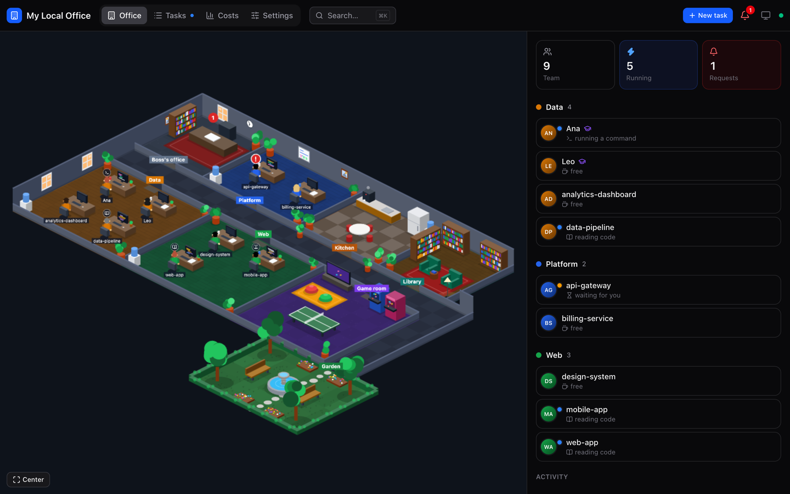
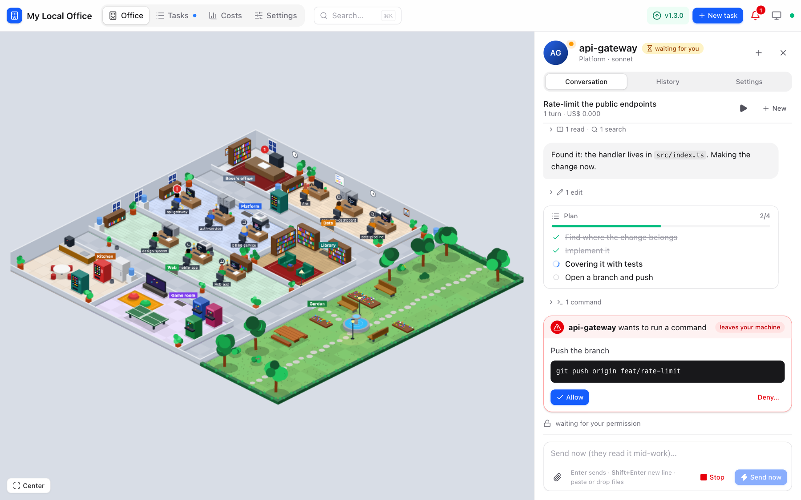
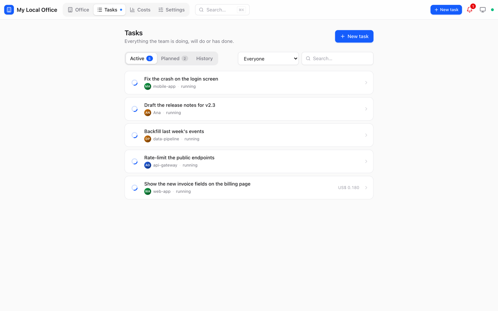
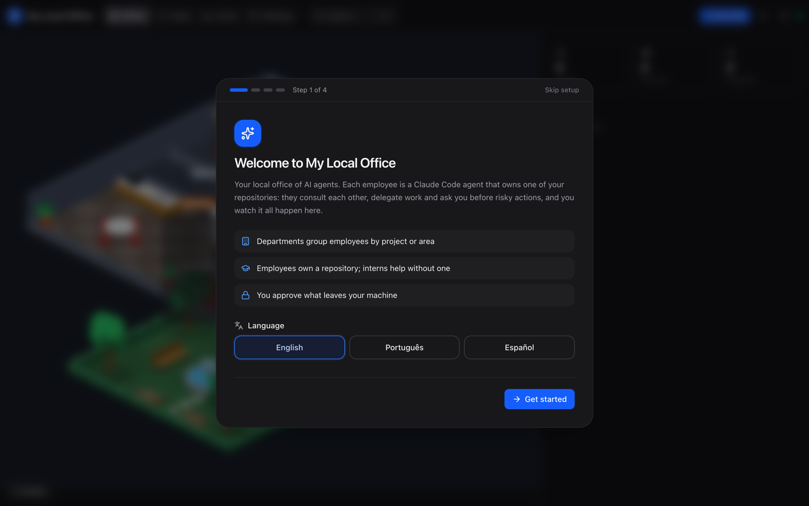
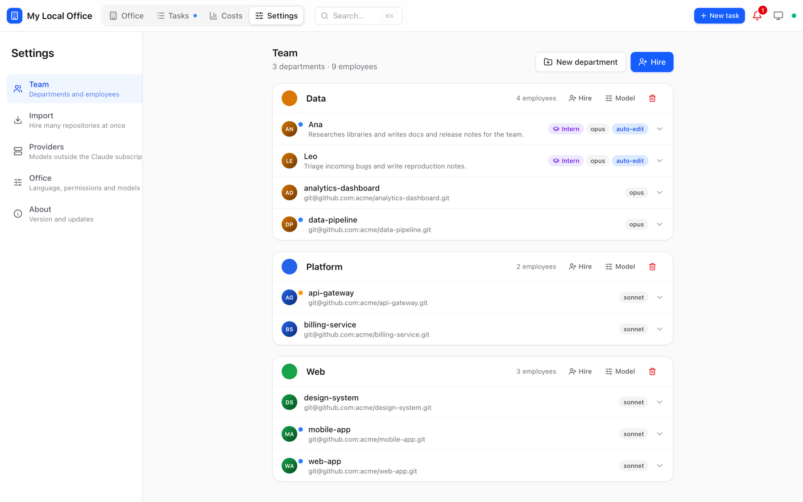

# My Local Office

A local, virtual office for your [Claude Code](https://docs.claude.com/claude-code) agents. Each employee is an agent that owns one of your repositories; employees are grouped in departments, consult each other, delegate work and ask you before anything risky. You watch it all happen in an isometric office and approve, answer or redirect from the UI.



| Conversation with an employee | Tasks |
|---|---|
|  |  |

| First access | Team settings |
|---|---|
|  |  |

Everything runs on your machine: a small Node server, a SQLite file and one `claude -p` process per task, using your Claude subscription (or any provider you configure).

## Install

macOS and Linux, Intel and ARM. You only need [Claude Code](https://docs.claude.com/claude-code) installed and logged in (`claude auth status`); Node comes bundled.

```bash
curl -fsSL https://github.com/alissonpelizaro/my-local-office/releases/latest/download/install.sh | bash
```

Then open **http://127.0.0.1:4410**. A setup assistant walks you through the language, your departments and your first hires.

The installer puts the app in `~/.my-local-office/app`, your data in `~/.my-local-office/data` and registers a background service (a LaunchAgent on macOS, a `systemd --user` unit on Linux) that starts on login and restarts if it crashes. Logs: `~/.my-local-office/data/office.log`.

| Option | |
|---|---|
| `--version v1.2.0` | Install a specific release |
| `--file my-local-office-<os>-<arch>.tar.gz` | Install a package you already downloaded |
| `--no-service` | Skip the service; start it yourself with `~/.my-local-office/app/scripts/start.sh` |

On Linux, run `loginctl enable-linger $USER` if the office should keep running without an open session.

### Updates

The office checks GitHub for a new release every few hours. When there is one, a badge shows up in the header and **Settings → About → Update now** downloads it, swaps the app folder (your data stays) and restarts the service. Running tasks are interrupted.

You can also update from the terminal by running the install command again. If macOS blocks the downloaded files (quarantine), the same script clears it:

```bash
curl -fsSL https://github.com/alissonpelizaro/my-local-office/releases/latest/download/install.sh | bash
```

### Uninstall

```bash
~/.my-local-office/app/scripts/uninstall.sh          # keeps ~/.my-local-office/data
~/.my-local-office/app/scripts/uninstall.sh --purge  # removes everything
```

### Configuration

Set these before running the installer (they are written into the service):

| Variable | Default | |
|---|---|---|
| `OFFICE_PORT` | `4410` | |
| `OFFICE_HOST` | `127.0.0.1` | `0.0.0.0` opens it to your network and requires `OFFICE_TOKEN` |
| `OFFICE_TOKEN` | | 16+ characters. On another device, open `http://<ip>:4410/?token=<token>` once (it becomes a cookie). Localhost never asks |
| `MLO_HOME` | `~/.my-local-office` | Install folder |
| `OFFICE_CLAUDE_BIN` | `claude` | |

Network access example: `OFFICE_HOST=0.0.0.0 OFFICE_TOKEN=$(openssl rand -hex 16) bash install.sh`. Whoever has the token runs agents on your machine: trusted networks only.

Tunnels (ngrok, cloudflared) pointing at `localhost:4410` follow the same rule: set `OFFICE_TOKEN` (keep `OFFICE_HOST` on loopback) and open `https://<tunnel>/?token=<token>` once. Without a token, only localhost is accepted.

## How it works

- **Departments** group employees by project, product or area. Each one is a room in the office.
- **Employees** own a git repository. Each task is a `claude -p` process (stream-json) running in the repo, so it inherits your `~/.claude/CLAUDE.md`, the repo's `CLAUDE.md`, skills and allowlists. On hire, a quick read-only onboarding writes the employee's profile, which colleagues use to know whom to ask.
- **Interns** are not tied to a repository. They work in their own folder (`data/workspaces/`) on research, writing, analysis and errands, and ask the owners when code is involved.
- **The `office` MCP** connects them:
  - `directory`: who takes care of what
  - `ask_colleague`: a read-only consultation in the colleague's repository
  - `delegate_task`: a task for another employee (needs your approval by default)
  - `ask_boss`: a question for you
  - `approve`: the permission prompt
- **Permissions**: whatever your settings do not already allow becomes a request in the UI (and a "!" over the employee). External actions (`git push`, opening/merging PRs, publish, docker, sending messages…) always ask. Read-only shell commands can run without asking.
- **Providers**: each employee (or a whole department, in one click) uses the Claude subscription or a remote provider. Anthropic-compatible providers are called directly; OpenAI-compatible ones go through a built-in bridge. A local Ollama works too (set its context to ~64K).
- **Conversations**: click an employee to chat. Each message continues the same Claude session; while a turn is running, your message goes in right away. Sessions you opened outside the office (terminal, IDE) can be continued as a copy.
- **Tasks** run now, at a set time or on repeat (e.g. every 15 min). A repeating task can have a pre-check command: no output means nothing to do and no tokens spent.
- **Worktrees**: per employee, tasks run in the main copy or always in an isolated `git worktree`; parallel tasks use worktrees automatically.
- **Costs** per day, department and employee (on a subscription it is the API-price equivalent, useful to compare usage).
- **Languages**: English, Portuguese and Spanish, chosen in Settings. Agents reply in the same language.
- **Shortcuts**: `N` new task, `⌘K` search employees, tasks and actions, `Esc` closes the panel.

## Development

Requires Node 22.18+ (see `.tool-versions`) and pnpm.

```bash
pnpm install
pnpm dev          # server with --watch + Vite on http://127.0.0.1:5173
pnpm build        # builds apps/web/dist
pnpm start        # server + UI on http://127.0.0.1:4410 (data in ./data)
pnpm test
pnpm typecheck
```

`pnpm install-service` registers a LaunchAgent that runs the source checkout (macOS); `pnpm uninstall-service` removes it.

| Folder | |
|---|---|
| `apps/server/src` | `runner.ts` (Claude Code CLI), `mcp.ts`, `office.ts` (tasks, approvals, consultations), `policy.ts`, `update.ts`, `bridge.js` |
| `apps/web/src` | `store.ts` (state, SSE, replay), `components/`, `office/` (isometric floor plan and Phaser scene), `i18n/` |
| `scripts` | `install.sh`, `uninstall.sh`, `start.sh`, `build-release.sh` |

### Releases

PR titles follow [Conventional Commits](https://www.conventionalcommits.org). Release Drafter labels each PR and keeps a draft of the next version (`feat` → minor, `fix`/`chore`/`docs` → patch, `!` → major). Publishing the draft triggers the release workflow, which builds one package per platform with Node bundled, attaches them and `install.sh` to the release and checks that the package installs and starts on macOS and Linux.
